<p align="center">
  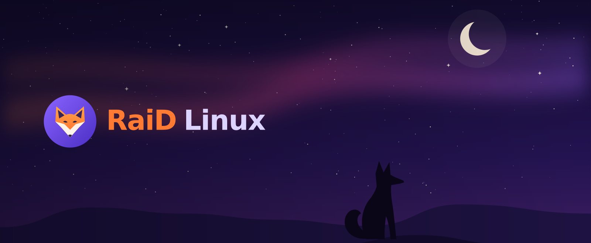
</p>

<h3 align="center">Создано пушистиками для пушистиков :3</h3>

<p align="center">
  Дистрибутив на базе Debian 13 с KDE Plasma 6: магазин приложений в духе App&nbsp;Store,<br>
  рабочий стол в стиле macOS и облегчённый режим, который оживляет даже слабые ноутбуки.
</p>

<p align="center">
  <a href="../../releases/latest"></a>
  
  
  
</p>

<p align="center">
  <a href="../../releases/latest"><b>Скачать</b></a>&nbsp;&nbsp;·&nbsp;&nbsp;
  <a href="#как-установить">Установить</a>&nbsp;&nbsp;·&nbsp;&nbsp;
  <a href="#как-обновить">Обновить</a>&nbsp;&nbsp;·&nbsp;&nbsp;
  <a href="#сборка-из-исходников">Собрать самому</a>&nbsp;&nbsp;·&nbsp;&nbsp;
  <a href="mailto:raidbronywork@yandex.ru">Поддержка</a>
</p>

<p align="center">
  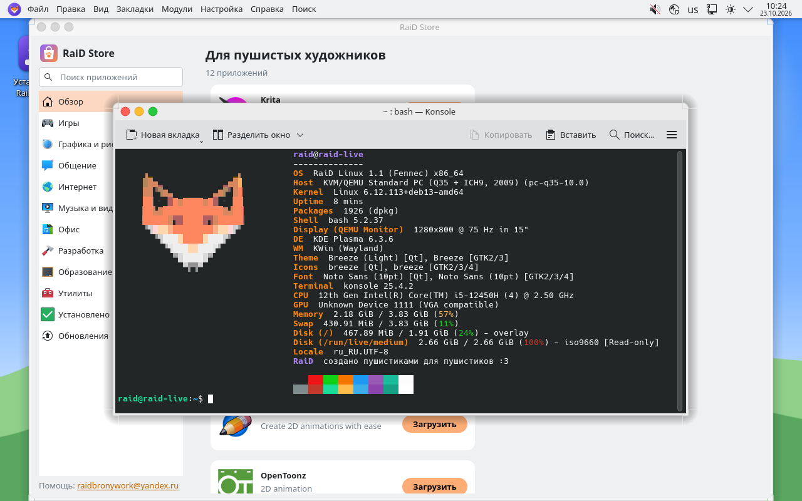
</p>

## Что внутри

| | Коротко |
|---|---|
| 🦊 **Два вида рабочего стола** | **RaiD Classic** — тёмный, с панелью внизу, как в Windows. **RaiD Aqua** — светлый, как на MacBook: строка меню с меню программы сверху, док снизу, кнопки окон «светофором» слева. Переключаются в два щелчка |
| 🛍️ **RaiD Store** | Тысячи приложений из Debian и Flathub в одном магазине: подборки, категории, скриншоты, установка и обновления в один щелчок. Открывается за доли секунды |
| 🐾 **Для слабых ноутбуков** | Сжатие памяти, защита от зависаний при нехватке памяти и облегчённый режим рабочего стола, который включается сам |
| 🔧 **RaiD Tune** | Аналог ThrottleStop: частоты, температуры и причины троттлинга по ядрам, лимиты мощности PL1/PL2, турбобуст, андервольт, профили |
| 🎮 **Драйверы в один щелчок** | NVIDIA (в том числе ноутбуки с гибридной графикой и Secure Boot), Wi-Fi Broadcom, ускорение видео Intel, прошивки AMD, микрокод |
| 🛠️ **RaiD Build** | Сборка программы из исходников: щелчок правой кнопкой по папке или архиву, зависимости находятся сами, результат ставится как обычный пакет |
| 💿 **Простой установщик** | Как в Windows, только гибче: одиннадцать рабочих столов на выбор, LibreOffice или Apache OpenOffice, наборы программ, установка рядом с Windows, шифрование диска |
| 💬 **По-русски** | Система, установщик и все свои программы на русском; раскладки us/ru, Alt+Shift |

## Два вида рабочего стола

<table>
  <tr>
    <td width="50%">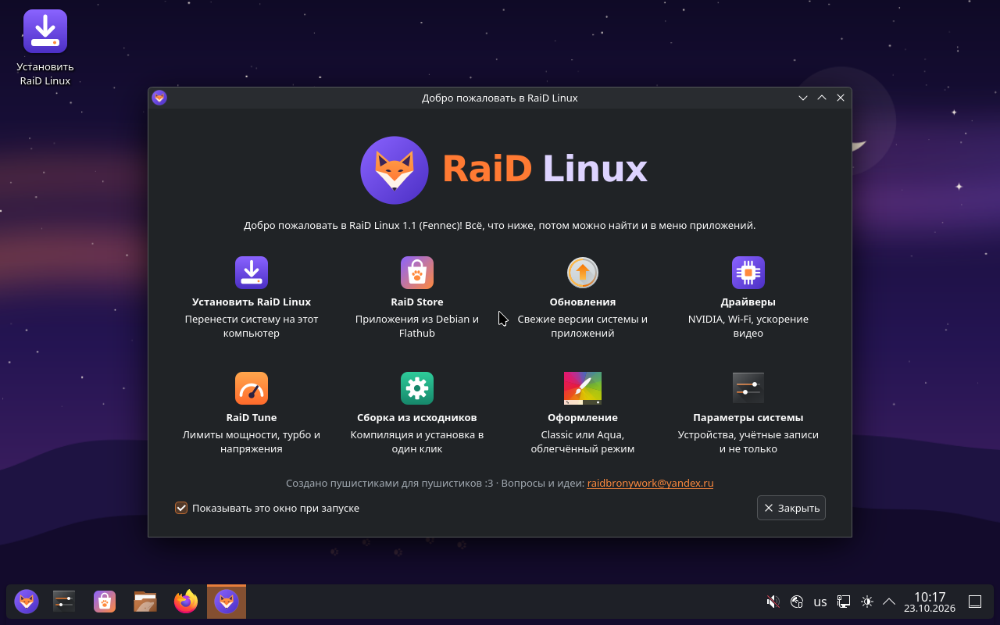</td>
    <td width="50%">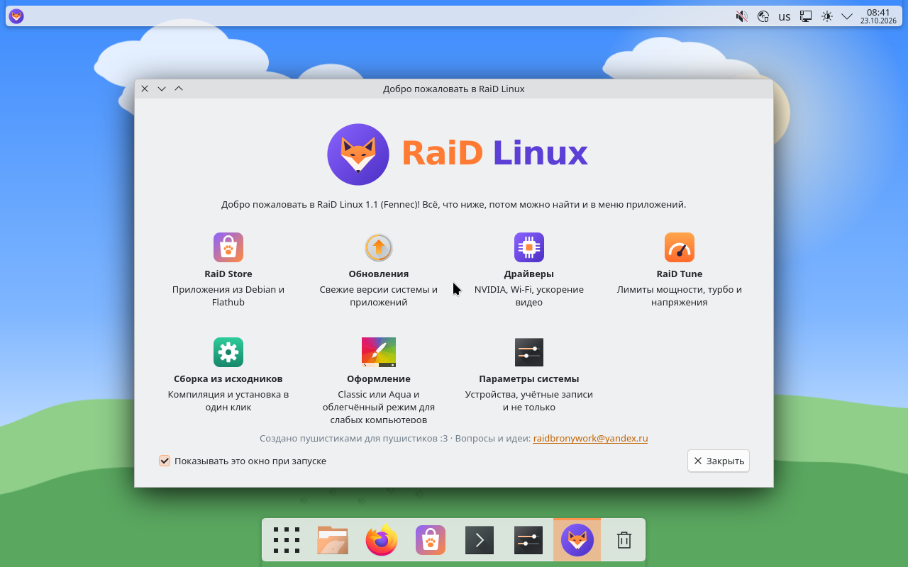</td>
  </tr>
  <tr>
    <td align="center"><b>RaiD Classic</b><br>Тёмная тема, обои «Фенек», панель внизу</td>
    <td align="center"><b>RaiD Aqua</b><br>Строка меню, док, обои «Фенек днём»</td>
  </tr>
</table>

Вид выбирается при установке, а потом меняется в приложении «Добро пожаловать» →
«Оформление». В комплекте пять обоев — «Фенек», «Фенек днём», «Северное сияние»,
«Закат» и «Следы лап» — во всех популярных разрешениях до 4K.

## RaiD Store

<table>
  <tr>
    <td width="50%">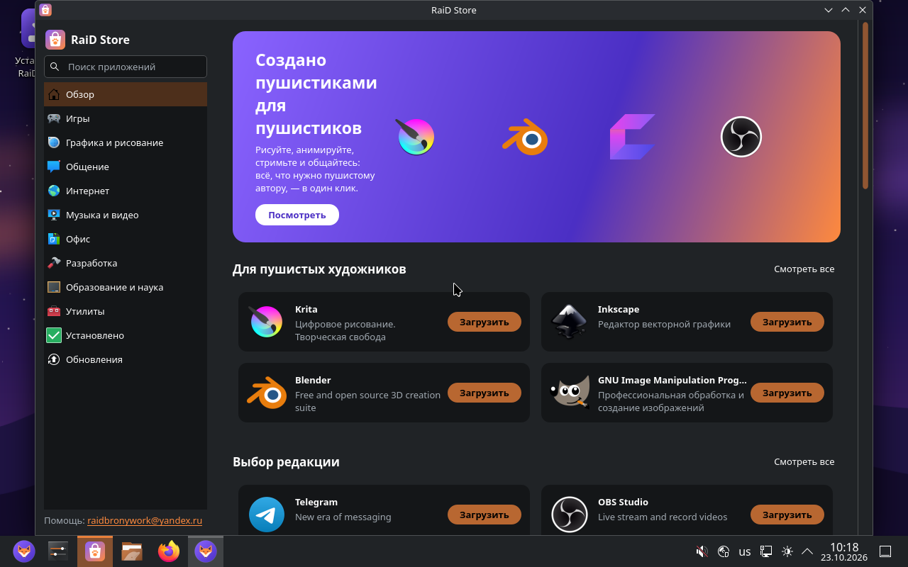</td>
    <td width="50%">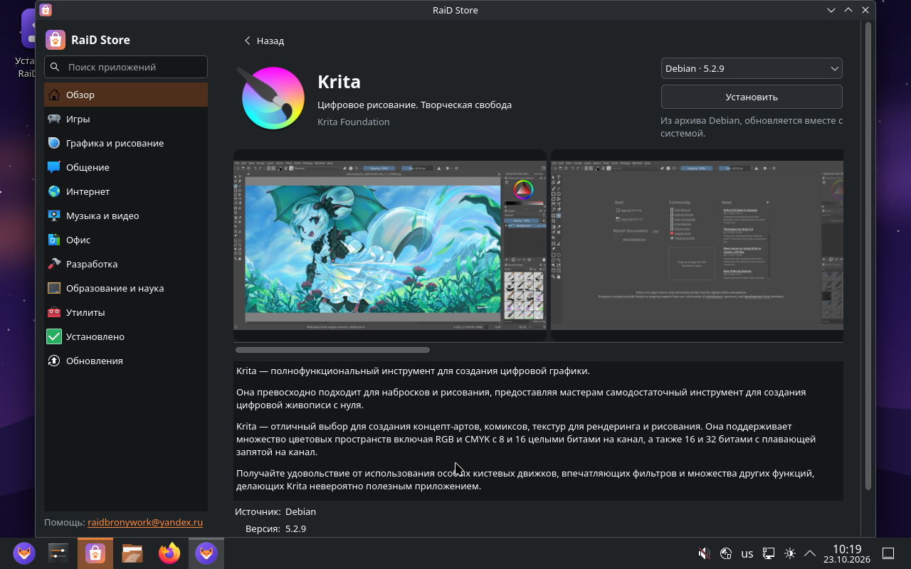</td>
  </tr>
</table>

* Приложения из **Debian** и **Flathub** в одном каталоге; если программа есть и
  там и там, на её странице можно выбрать, откуда ставить.
* Подборки «Для пушистых художников», «Выбор редакции», «Играть», «Оставайтесь
  на связи» и другие, поиск по-русски.
* Кнопка «Загрузить» на карточке сразу ставит программу, «Открыть» — запускает.
* Страница «Обновления» и уведомления о них дважды в день.
* **Apache OpenOffice**, которого нет ни в Debian, ни на Flathub, скачивается
  с apache.org и проверяется по контрольной сумме.

## Работает и на слабом ноутбуке

RaiD Linux проверяется в виртуальной машине, похожей на слабый ноутбук: **2 ГБ
памяти, два ядра и никакого ускорения графики**. Установленная система
загружается в ней за 13 секунд, RaiD Store открывается меньше чем за 4.

| Что сделано | Зачем |
|---|---|
| **Сжатие памяти (zram)** | На ноутбуке с 4 ГБ помещается примерно вдвое больше открытого, прежде чем система полезет на диск |
| **earlyoom** | Когда память совсем кончается, закрывается самая прожорливая вкладка браузера, а не зависает весь компьютер |
| **Облегчённый режим** | Без анимаций, размытия и заставки при входе, рамки окон рисует быстрая тема Breeze. Включается сам, если памяти меньше 6 ГБ, потоков процессора два или нет ускорения графики |
| **Планировщик BFQ** | Жёсткий диск или eMMC заняты копированием, а система всё равно отзывается |
| **Индексация только имён файлов** | Компьютер не перечитывает все документы часами после установки |
| **Короткие таймауты** | Выключение не зависает на полторы минуты из-за упрямой службы |

<p align="center">
  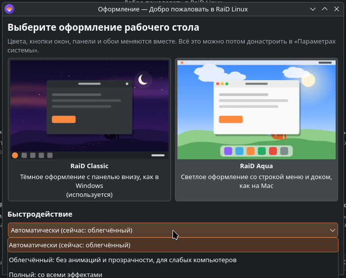
</p>

Режим можно выбрать и вручную: «Добро пожаловать» → «Оформление» →
«Быстродействие» или в терминале `raid-performance light`, `full` или `auto`.

## Установщик

<table>
  <tr>
    <td width="50%">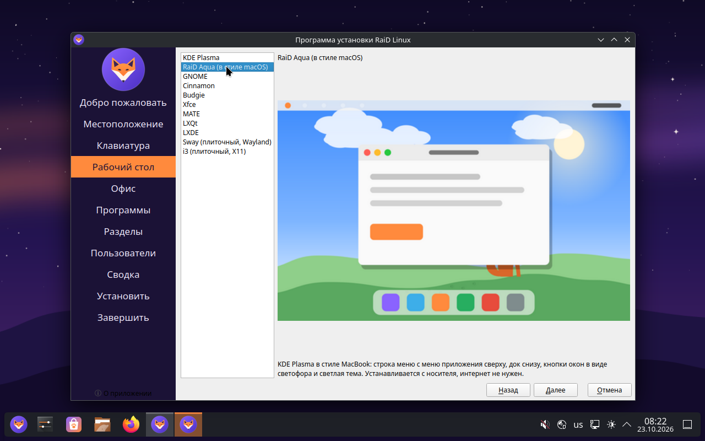</td>
    <td width="50%">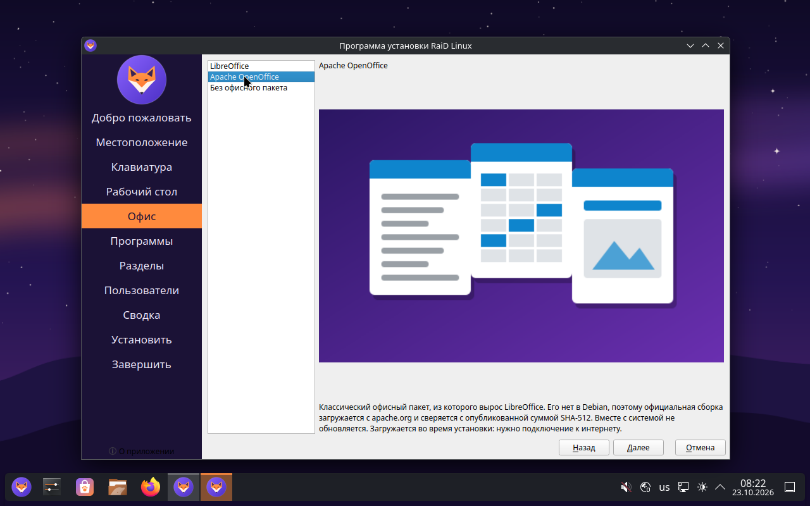</td>
  </tr>
</table>

* **Рабочий стол:** KDE Plasma и RaiD Aqua ставятся прямо с флешки, без
  интернета. GNOME, Cinnamon, Budgie, Xfce, MATE, LXQt, LXDE, а также плиточные
  Sway и i3 скачиваются во время установки.
* **Офис:** LibreOffice из Debian, Apache OpenOffice с apache.org или без офиса.
* **Программы:** рисование (Krita, Inkscape, GIMP), игры (Lutris, GameMode),
  стриминг (OBS, Kdenlive), 3D (Blender), почта, разработка.
* Установка рядом с Windows, шифрование диска, ext4, btrfs или xfs.

<table>
  <tr>
    <td width="50%">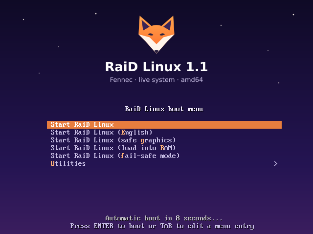</td>
    <td width="50%">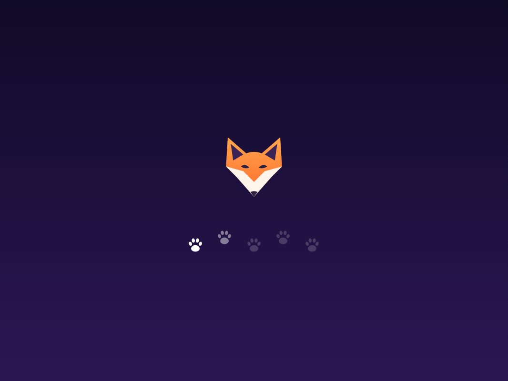</td>
  </tr>
  <tr>
    <td align="center">Меню загрузки</td>
    <td align="center">Лапки на заставке загораются по мере загрузки</td>
  </tr>
</table>

## Как установить

1. Откройте [последний выпуск](../../releases/latest) и скачайте все части образа:
    `raid-linux-1.1-amd64.iso.part1`, `.part2` (GitHub принимает файлы до 2 ГБ,
    поэтому образ разрезан).
2. Склейте части в одной папке.

    **Windows** (командная строка в папке с частями):

    ```
    copy /b raid-linux-1.1-amd64.iso.part1+raid-linux-1.1-amd64.iso.part2 raid-linux-1.1-amd64.iso
    ```

    **Linux:**

    ```
    cat raid-linux-1.1-amd64.iso.part* > raid-linux-1.1-amd64.iso
    ```

3. Сверьте контрольную сумму со строкой в `SHA256SUMS`:
    `certutil -hashfile raid-linux-1.1-amd64.iso SHA256` в Windows или
    `sha256sum raid-linux-1.1-amd64.iso` в Linux.
4. Запишите образ на флешку: **Rufus** (в режиме DD), **Ventoy** (просто
    скопировать ISO) или **balenaEtcher**.
5. Загрузитесь с флешки — запустится live-система. Попробуйте всё, а потом
    нажмите «Установить RaiD Linux» на рабочем столе.

**Нужно:** 64-битный компьютер с BIOS или UEFI (Secure Boot поддерживается),
2 ГБ памяти (лучше 4), 20 ГБ на диске. Интернет нужен только для рабочих
столов, кроме KDE Plasma и RaiD Aqua, офиса и дополнительных программ.

## Как обновить

Обновление с 1.0 до 1.1 работает **без интернета**: все пакеты лежат в архиве.

1. Скачайте `RaiD-Linux-1.1-update.zip` из [последнего выпуска](../../releases/latest)
    (или скопируйте папку обновления на флешку).
2. В Dolphin щёлкните по архиву правой кнопкой → «Распаковать» →
    «Распаковать в эту папку».
3. Зайдите в папку `RaiD-Linux-1.1-update`, щёлкните правой кнопкой по пустому
    месту → «Открыть терминал в этой папке» и введите:

    ```
    sudo sh install-update.sh
    ```

4. Когда появится «Готово!», перезагрузите компьютер.

<p align="center">
  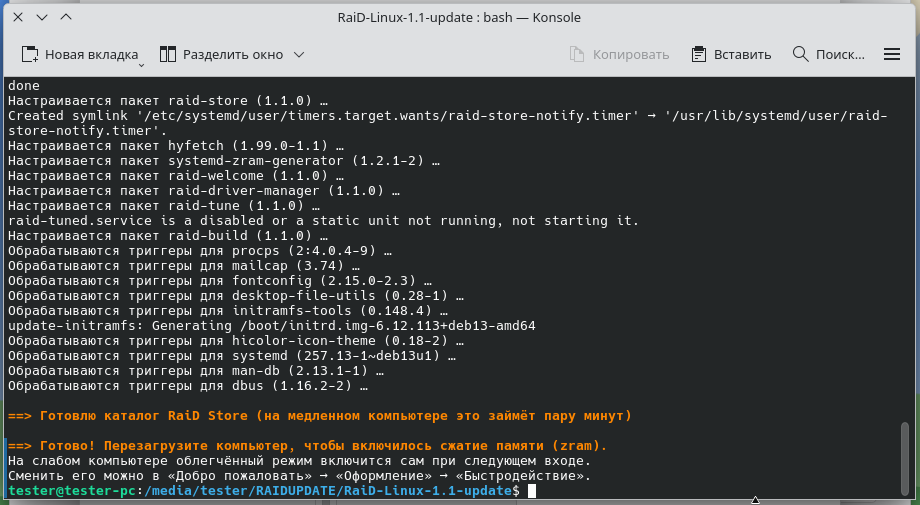
</p>

## Частые вопросы

<details>
<summary><b>Нужен драйвер NVIDIA 512.15. Он есть?</b></summary>

<br>

**512.15 — это номер драйвера для Windows**: у NVIDIA нет Linux-драйвера с таким
номером, Windows и Linux нумеруются по-разному. Он относится к ветке R510, а её
Linux-выпуски (510.39–510.108) не собираются на ядре Linux 6.12 из Debian 13 —
менеджер драйверов это проверит и объяснит.

Для видеокарт, которые поддерживала R510, включая RTX 3050 Laptop, подходит
драйвер **550 из Debian**: менеджер драйверов → «Применить изменения». Там же
есть вариант с открытыми модулями ядра и установка любой другой версии
с nvidia.com.

</details>

<details>
<summary><b>Система зависла на заставке с лисой</b></summary>

<br>

* Нажмите **Esc**: заставка скроется, и будет видно, на каком шаге всё
  остановилось.
* В VirtualBox выберите видеоконтроллер **VMSVGA**, выключите 3D-ускорение,
  дайте машине хотя бы 4 ГБ памяти и 2 ядра. Если в Windows включены WSL2 или
  Hyper-V, VirtualBox работает в медленном режиме (зелёная черепаха в строке
  состояния), и загрузка занимает минуты.
* После установки извлеките ISO из виртуального привода.
* Не помогло — напишите на [raidbronywork@yandex.ru](mailto:raidbronywork@yandex.ru):
  программа виртуализации, live или установленная система и последние строки
  после Esc.

</details>

<details>
<summary><b>Почему нет Hyprland?</b></summary>

<br>

Его нет в Debian 13. Из плиточных окружений установщик предлагает Sway (Wayland)
и i3 (X11) с готовыми настройками.

</details>

<details>
<summary><b>Андервольт в RaiD Tune не работает</b></summary>

<br>

На Intel Core 12-го поколения и новее его обычно блокирует производитель (Undervolt
Protection); RaiD Tune это определит и покажет. Кроме того, при включённом Secure
Boot ядро запрещает запись в регистры процессора. Лимиты мощности работают в
любом случае.

</details>

<details>
<summary><b>Обновляется ли Apache OpenOffice?</b></summary>

<br>

Нет: его нет в Debian, поэтому новый выпуск ставится повторной установкой из
RaiD Store. LibreOffice обновляется вместе с системой.

</details>

## Сборка из исходников

Нужен Debian 13 (или WSL в Windows), около 25 ГБ места и интернет. Первая сборка
занимает 40–90 минут, следующие быстрее: пакеты кешируются.

**Windows** — скрипт сам создаст WSL-дистрибутив `RaiD-Builder` с Debian 13:

```powershell
.\build.ps1 iso        # образ
.\build.ps1 update     # обновление для флешки
.\build.ps1 release    # файлы для выпуска на GitHub
```

**Debian 13:**

```sh
sudo apt install live-build build-essential debhelper dh-python gettext \
    librsvg2-bin imagemagick fonts-dejavu-core chafa python3-polib apt-utils
sudo make iso update release
```

Результат — в папке `out`: образ, папка обновления и `github-release`. Как
опубликовать выпуск, подробно написано в [docs/github.md](docs/github.md).

<details>
<summary><b>Проверки и тест в виртуальной машине</b></summary>

<br>

```sh
make packages            # только пакеты raid-* (out/debs)
scripts/check.sh         # pyflakes, shellcheck, наличие всех пакетов в Debian
make test                # загрузка образа в QEMU (UEFI)
```

</details>

<details>
<summary><b>Устройство репозитория</b></summary>

<br>

```
packages/
  raid-base/                os-release, «О системе», fastfetch, neowofetch и hyfetch
                            с лисой, настройки быстродействия, raid-performance
  raid-artwork/             логотип, обои, заставки, темы Classic и Aqua, SDDM, GRUB
  raid-tools/               RaiD Store, RaiD Tune, менеджер драйверов, RaiD Build,
                            «Добро пожаловать» (Python и PyQt6, перевод в po/)
  calamares-settings-raid/  установщик: модули Calamares, оформление, скрипты
live-build/                 списки пакетов, хуки и меню загрузки образа
scripts/                    сборка пакетов, образа, обновления и выпуска, проверки
docs/                       скриншоты, публикация на GitHub
```

Пакеты Debian берутся из архива без изменений; всё своё лежит в отдельных пакетах
`raid-*`, собранных по правилам Debian.

</details>

<details>
<summary><b>Как поменять под себя</b></summary>

<br>

* **Название и версия** — `VERSION`, `packages/raid-base/os-release`,
  `packages/calamares-settings-raid/branding/raid/branding.desc`,
  `live-build/auto/config`.
* **Адрес поддержки** — `SUPPORT_URL` в `packages/raid-base/os-release`
  (программы RaiD берут его оттуда), `kcm-about-distrorc`, слайд-шоу установщика
  и `packages/*/debian/control`.
* **Программы в образе** — `live-build/config/package-lists/`, KDE-часть —
  `packages/calamares-settings-raid/desktops/kde.list`.
* **Подборки RaiD Store** — `COLLECTIONS` и `HERO` в
  `packages/raid-tools/raidlinux/store/catalog.py`.
* **Обои** — палитры в `packages/raid-artwork/tools/gen-wallpaper.py`.

</details>

## Поддержка

Вопросы, проблемы и идеи — на **[raidbronywork@yandex.ru](mailto:raidbronywork@yandex.ru)**.
Если что-то сломалось, напишите, какой у вас компьютер, что делали и что
появилось на экране.

## Лицензия

Код распространяется по **GPL-2.0-or-later**, настройки установщика — по
**GPL-3.0-or-later**, обои, логотип и темы — по **CC BY-SA 4.0**. Подробности —
в файлах `packages/*/debian/copyright`. Пакеты Debian — по своим лицензиям.

<br>

<p align="center">
  
  <br>
  <sub>RaiD Linux — создано пушистиками для пушистиков :3</sub>
</p>
